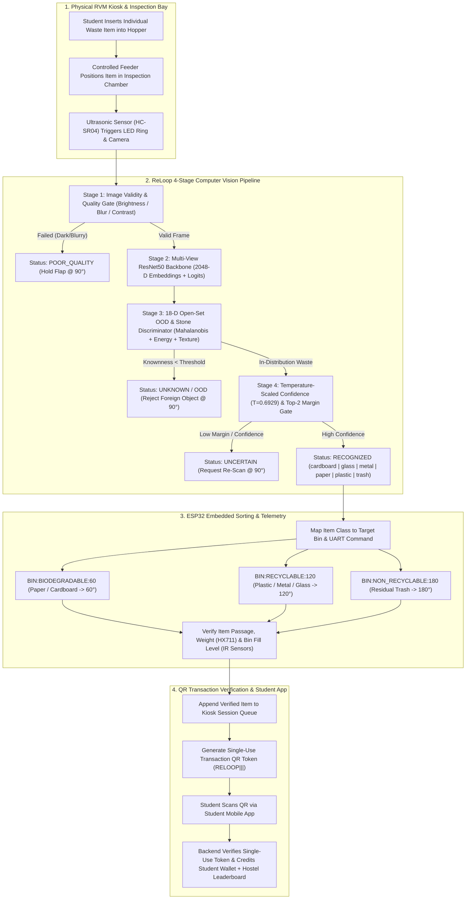
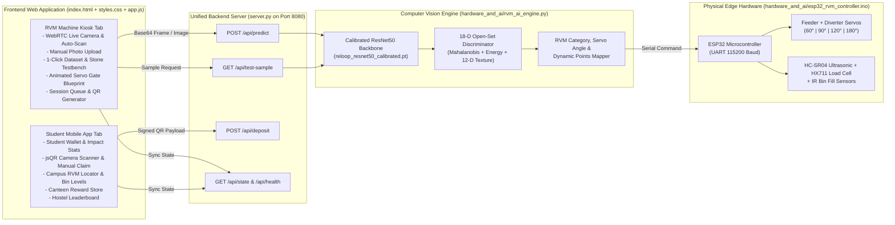

# ReLoop (EcoSort Campus) — AI-Powered Smart Waste Segregation & Rewards Ecosystem

> **"Don't ask people to care about waste. Give them a reason to."**  
> **Tagline:** *Waste. Reward. Repeat.*

[](https://www.python.org/)
[](https://pytorch.org/)
[](#5-ai-model-dataset--open-set-ood-evaluation)
[](#5-ai-model-dataset--open-set-ood-evaluation)
[](#6-hardware-architecture--embedded-controller-esp32)

---

## Table of Contents

1. [Project Overview](#1-project-overview)
2. [Core Concept & Vision](#2-core-concept--vision)
3. [Complete End-to-End Working Mechanism](#3-complete-end-to-end-working-mechanism)
4. [System & Software Architecture](#4-system--software-architecture)
5. [AI Model, Dataset & Open-Set OOD Evaluation](#5-ai-model-dataset--open-set-ood-evaluation)
6. [Hardware Architecture & Embedded Controller (ESP32)](#6-hardware-architecture--embedded-controller-esp32)
7. [Reward Points & Dynamic Incentive System](#7-reward-points--dynamic-incentive-system)
8. [Kiosk Simulation & Student Mobile Application](#8-kiosk-simulation--student-mobile-application)
9. [Complete Repository Directory & File Mapping](#9-complete-repository-directory--file-mapping)
10. [REST API Reference](#10-rest-api-reference)
11. [Installation, Quick Start & Testing](#11-installation-quick-start--testing)
12. [Execution Roadmap & Practical Considerations](#12-execution-roadmap--practical-considerations)

---

## 1. Project Overview

**ReLoop (EcoSort Campus)** is an end-to-end AI-powered Reverse Vending Machine (RVM) and student rewards ecosystem designed for hostel canteens, academic blocks, and high-footfall locations across a college campus.

The primary objective is to **automate waste segregation at the source** while incentivizing students to dispose of waste responsibly through a **verified digital reward system**. The project combines:
- **Computer Vision & Open-Set Anomaly Detection:** A calibrated **ResNet50** transfer-learning classifier paired with an **18-dimensional Open-Set Out-of-Distribution (OOD) Discriminator** that identifies 6 waste categories (`cardboard`, `glass`, `metal`, `paper`, `plastic`, `trash`) at **94.71% test accuracy** while rejecting non-waste foreign objects (such as stones, hands, or blurry/empty frames) at **96.67% stone rejection** (`0.9997` OOD AUROC).
- **Embedded Mechatronics (`ESP32`):** Automated servo-actuated sorting diverter flaps (`60°`, `120°`, `180°`, and `90°` hold/reject) with ultrasonic object detection, HX711 load-cell weight verification, and IR bin-fullness telemetry.
- **Interactive RVM Kiosk & Student Companion App:** A dual-mode web application providing a full-featured **RVM Kiosk Touch Interface** (live camera, manual image upload, real-time dataset/OOD testbench, mechanical sorting visualization, and cryptographic QR ticket issuance) alongside a **Student Mobile App** (QR scanner, reward wallet, canteen coupon store, live campus machine locator, and hostel leaderboard).

---

## 2. Core Concept & Vision

Conventional colour-coded campus dustbins fail because mixed disposal contaminates recyclable streams at the very first step. ReLoop replaces passive bins with **intelligent Reverse Vending Machines (RVMs)** placed at hostel canteens:

1. **Automated Source Segregation:** Students insert waste items one by one into the RVM inspection bay. The machine identifies the material using computer vision and physically routes it into isolated collection compartments (`Biodegradable / Fiber`, `Recyclable Containers`, or `Residual / Non-Recyclable`).
2. **Verified Student Participation:** Once a student finishes depositing items, the RVM generates a single-use cryptographic transaction QR code. Scanning this code on the student's phone credits their campus wallet with reward points proportional to the material's recyclability and recovery value.
3. **Tangible Campus Rewards:** Earned points are redeemable at campus canteens for tea/coffee discounts, meal vouchers, stationery, and hostel competition points.
4. **Closed-Loop Recovery:** Uncontaminated segregated streams are collected according to live bin-capacity telemetry and transferred to authorized recycling and composting partners.

---

## 3. Complete End-to-End Working Mechanism



### Step-by-Step Operational Lifecycle

1. **Single-Item Insertion:** A student places an item into the RVM inspection bay (or captures/uploads an image in the kiosk interface). Processing one item at a time prevents occlusion and ensures clean mechanical routing.
2. **Pre-Inference Quality Gate:** Before invoking deep neural inference, the engine inspects luminance (`12 <= brightness <= 248`), pixel standard deviation (`std >= 10.0`), and Laplacian edge sharpness (`blur_var >= 18.0`) to reject covered cameras or motion-blurred frames (`POOR_QUALITY`).
3. **Deep Feature & Material Extraction:** The image is evaluated across a 2-view ensemble (`224x224` full resize + `256->224` center crop) through the fine-tuned **ResNet50** backbone to extract a `2048-D` feature embedding alongside a `12-D` physical color/saturation/texture descriptor.
4. **Open-Set OOD & Stone Rejection:** An 18-dimensional Logistic Regression + MLP Open-Set Discriminator combines class-conditional Mahalanobis distances, cosine similarity to class centroids, logit energy, Shannon entropy, and material texture descriptors. Foreign objects like stones, bricks, or hands are immediately flagged as `UNKNOWN` (`REJECT:OOD:90`) instead of being forced into a waste class.
5. **Confidence & Margin Verification:** Valid waste items pass through temperature-scaled softmax calibration (`T = 0.6929`). If calibrated confidence or the top-2 probability margin is too low, the system flags `UNCERTAIN` (`HOLD:UNCERTAIN:90`) and asks the user to reposition the item.
6. **Mechatronic Actuation:** Recognized items trigger an ESP32 UART command (`BIN:BIODEGRADABLE:60`, `BIN:RECYCLABLE:120`, or `BIN:NON_RECYCLABLE:180`). The MG996R servo tilts the sorting chute for `1.5 seconds`, drops the item into the target bin, and returns to neutral (`90°`).
7. **QR Token Issuance & Redemption:** The student adds one or more items to their disposal session and taps **Finish & Generate Reward QR**. Scanning the resulting QR code in the **Student App** calls `POST /api/deposit`, which verifies the transaction ID, prevents duplicate replay claims, updates bin capacity telemetry, and credits the student's wallet.

---

## 4. System & Software Architecture



### Technology Stack

| Layer | Technology | Role in ReLoop |
| :--- | :--- | :--- |
| **Computer Vision & Deep Learning** | **PyTorch**, **Torchvision (`ResNet50`)**, **Scikit-Learn**, **NumPy**, **Pillow** | Multi-view transfer learning, temperature scaling (`T=0.6929`), L2-regularized head calibration, and 18-D Open-Set OOD detection. |
| **Backend API & State Engine** | **Python `ThreadingHTTPServer`** ([`server.py`](file:///c:/Users/Archit/HTML/NSS_Sociothon/server.py)) | Serves static assets and REST endpoints (`/api/predict`, `/api/test-sample`, `/api/deposit`, `/api/state`, `/api/health`) on a single port (`8080`) with zero CORS friction. |
| **Frontend Kiosk & Student App** | **HTML5**, **CSS3 (ReLoop Design System)**, **Vanilla ES6 JavaScript** ([`index.html`](file:///c:/Users/Archit/HTML/NSS_Sociothon/index.html), [`styles.css`](file:///c:/Users/Archit/HTML/NSS_Sociothon/styles.css), [`app.js`](file:///c:/Users/Archit/HTML/NSS_Sociothon/app.js)) | Responsive dual-view interface (`RVM Machine` Kiosk + `Student App`), WebRTC camera capture, `qrcode.js` ticket rendering, and `jsQR` scanner. |
| **Embedded Hardware Firmware** | **C++ / Arduino (`ESP32`)** ([`esp32_rvm_controller.ino`](file:///c:/Users/Archit/HTML/NSS_Sociothon/hardware_and_ai/esp32_rvm_controller.ino)) | Controls MG996R sorting servos, HC-SR04 ultrasonic trigger, HX711 load-cell amplifier, SSD1306 OLED display, and bin-level IR sensors. |
| **Automated Verification** | **Python `unittest`** ([`tests/test_reloop_system.py`](file:///c:/Users/Archit/HTML/NSS_Sociothon/tests/test_reloop_system.py)) | End-to-end verification of valid waste classification, stone/OOD rejection, poor-quality frame rejection, and single-use QR deposit anti-replay. |

---

## 5. AI Model, Dataset & Open-Set OOD Evaluation

### 5.1 Dataset Composition & Integrity Audit

The model is trained and evaluated on the **TrashNet-derived 6-class dataset** managed inside [`waste-classification-ai-main/`](file:///c:/Users/Archit/HTML/NSS_Sociothon/waste-classification-ai-main/README.md) with deterministic stratified splits (`seed = 42`, `70% Train / 15% Val / 15% Test`) defined in [`splits.csv`](file:///c:/Users/Archit/HTML/NSS_Sociothon/waste-classification-ai-main/data/processed/splits.csv):

| Class Label | Train Split (70%) | Validation Split (15%) | Test Split (15%) | Total Images | Target RVM Compartment |
| :--- | :---: | :---: | :---: | :---: | :--- |
| **`cardboard`** | 282 | 60 | 61 | **403** | Biodegradable / Fiber (`60°`) |
| **`glass`** | 350 | 75 | 76 | **501** | Recyclable Containers (`120°`) |
| **`metal`** | 287 | 61 | 62 | **410** | Recyclable Containers (`120°`) |
| **`paper`** | 416 | 89 | 89 | **594** | Biodegradable / Fiber (`60°`) |
| **`plastic`** | 337 | 72 | 73 | **482** | Recyclable Containers (`120°`) |
| **`trash`** | 96 | 20 | 21 | **137** | Non-Recyclable / Residual (`180°`) |
| **Total** | **1,768** | **377** | **382** | **2,527** | **Zero Corrupted Files (`0`)** |

### 5.2 Root Causes Identified During Audit & Engineering Fixes

1. **Complete Absence of Open-Set / OOD Rejection in Baseline:** Standard closed-set softmax forces *every* arbitrary image into one of the 6 waste classes with high confidence. Evaluating the baseline ResNet50 on 60 stone/rock images resulted in **0.0% rejection** (stones were misclassified as `paper`, `cardboard`, or `trash`).
   - **Fix:** Engineered an **18-dimensional Open-Set Discriminator** ([`upgrade_ood_detector.py`](file:///c:/Users/Archit/HTML/NSS_Sociothon/waste-classification-ai-main/src/training/upgrade_ood_detector.py)) combining:
     - Temperature-scaled maximum probability, logit energy, normalized Shannon entropy, and top-2 margin (`4` features).
     - Class-conditional regularized Mahalanobis distance and cosine similarity to normalized `2048-D` class prototypes (`2` features).
     - Physical `12-D` material & texture descriptors: RGB means/stds, HSV saturation mean/std, achromatic gray-pixel ratio, color channel spread, Laplacian texture variance, and central-vs-border contrast (`12` features).
2. **`Trash` Class Bias & Overconfidence (`ECE = 0.0457`):** Inverse-frequency class weighting during baseline training inflated the `trash` logit bias (`3.38x` weight), causing ambiguous shadows or hands to default to `trash`.
   - **Fix:** Retrained a balanced L2-regularized linear classification head (`C = 0.25`) on 2-view extracted ResNet50 embeddings blended with the backbone head (`alpha = 0.85`) and calibrated via temperature scaling (`T = 0.6929`), cutting Expected Calibration Error (`ECE`) by **34.6%** (`0.0457 -> 0.0299`) and improving `trash` F1 from `0.8182` to `0.8780`.

### 5.3 Quantitative Benchmark Comparison (382 Test Images + 150 OOD Samples)

All metrics below are reproducible via [`reloop_pipeline.py`](file:///c:/Users/Archit/HTML/NSS_Sociothon/waste-classification-ai-main/src/training/reloop_pipeline.py) and [`upgrade_ood_detector.py`](file:///c:/Users/Archit/HTML/NSS_Sociothon/waste-classification-ai-main/src/training/upgrade_ood_detector.py), and stored in [`reloop_overhaul_evaluation.json`](file:///c:/Users/Archit/HTML/NSS_Sociothon/waste-classification-ai-main/reports/results/reloop_overhaul_evaluation.json):

| Metric | Baseline `resnet50_best.pt` | Calibrated `reloop_resnet50_calibrated.pt` | Improvement |
| :--- | :---: | :---: | :---: |
| **Held-Out Test Accuracy (`N=382`)** | 94.24% | **94.71%** | **+0.47%** |
| **Test Macro F1-Score** | 0.9355 | **0.9469** | **+1.14%** |
| **Validation Accuracy (`N=377`)** | 94.43% | **94.96%** | **+0.53%** |
| **Expected Calibration Error (`ECE`)** | 0.0457 | **0.0299** | **-34.6% (Better Calibrated)** |
| **OOD Detection AUROC (`150 OOD vs 382 ID`)** | 0.8610 | **0.9997** | **+0.1387 (+16.1%)** |
| **Stone / Rock Rejection Rate (`60 Stone Samples`)** | 0.00% | **96.67%** (`58 / 60`) | **+96.67%** |
| **Overall OOD Rejection Rate (`150 Non-Waste Samples`)** | 0.00% | **98.67%** (`148 / 150`) | **+98.67%** |

### 5.4 Per-Class Held-Out Test Performance (`N = 382`)

| Class | Precision | Recall | F1-Score | Support |
| :--- | :---: | :---: | :---: | :---: |
| **`cardboard`** | 0.9667 | 0.9508 | **0.9587** | 61 |
| **`glass`** | 0.9359 | 0.9605 | **0.9481** | 76 |
| **`metal`** | 0.9365 | 0.9516 | **0.9440** | 62 |
| **`paper`** | 0.9560 | 0.9775 | **0.9667** | 89 |
| **`plastic`** | 0.9559 | 0.8904 | **0.9220** | 73 |
| **`trash`** | 0.9000 | 0.8571 | **0.8780** | 21 |
| **Macro Average** | **0.9418** | **0.9313** | **0.9469** | **382** |

---

## 6. Hardware Architecture & Embedded Controller (`ESP32`)

Full hardware schematics, Bill of Materials (BOM), and wiring instructions are documented in [`HARDWARE_AND_WORKFLOW_DOCS.md`](file:///c:/Users/Archit/HTML/NSS_Sociothon/HARDWARE_AND_WORKFLOW_DOCS.md), and the production microcontroller firmware is located in [`hardware_and_ai/esp32_rvm_controller.ino`](file:///c:/Users/Archit/HTML/NSS_Sociothon/hardware_and_ai/esp32_rvm_controller.ino).

### 6.1 Physical Sequence

$$\text{Waste Hopper} \longrightarrow \text{Controlled Feeder} \longrightarrow \text{Camera \& LED Array} \longrightarrow \text{AI Inference Node} \longrightarrow \text{ESP32 Controller} \longrightarrow \text{Servo Sorting Gates} \longrightarrow \text{Segregated Bins}$$

### 6.2 ESP32 GPIO Pinout & Component Mapping

| Hardware Component | Model / Spec | ESP32 GPIO Pin | Function |
| :--- | :--- | :---: | :--- |
| **Sorting Diverter Servo** | `MG996R` High-Torque Metal Gear | `GPIO 13 (PWM)` | Tilts primary chute to `60°`, `120°`, `180°`, or holds at `90°` |
| **Chamber Drop-Trap Servo** | `SG90` / `MG996R` | `GPIO 12 (PWM)` | Releases inspected item from bay (`0°` closed -> `90°` drop) |
| **Ultrasonic Trigger & Echo** | `HC-SR04` | `GPIO 5` / `GPIO 18` | Detects item entry inside inspection chamber (`< 15 cm`) |
| **Load Cell Amplifier** | `HX711` + `5 kg` Load Cell | `GPIO 4` / `GPIO 16` | Measures item mass (`g`) to prevent hollow/fake deposits |
| **IR Bin Fullness Sensors (x3)** |LM393 IR Obstacle Modules | `GPIO 32, 33, 25` | Monitors fill levels for Biodegradable, Recyclable, and Residual bins |
| **OLED Kiosk Status Display** | `0.96"` I2C `SSD1306` | `GPIO 21 (SDA), 22 (SCL)` | Displays live machine status and points on physical kiosk |
| **Piezo Buzzer & Status LEDs** | `5V` Active Buzzer | `GPIO 26` | Audible confirmation on sort or alert on foreign object rejection |

### 6.3 Serial UART Communication Protocol (`115200 Baud`)

| AI Verdict / Category | Serial Command Sent to ESP32 | Servo Angle | Target Physical Compartment |
| :--- | :--- | :---: | :--- |
| **`paper`**, **`cardboard`** | `BIN:BIODEGRADABLE:60\n` | **`60°`** | Biodegradable & Clean Fiber Bin |
| **`plastic`**, **`metal`**, **`glass`** | `BIN:RECYCLABLE:120\n` | **`120°`** | High-Value Recyclable Container Bin |
| **`trash`** | `BIN:NON_RECYCLABLE:180\n` | **`180°`** | Isolated Residual / Non-Recyclable Bin |
| **`UNKNOWN` (Stone / OOD)** | `REJECT:OOD:90\n` | **`90°` (Hold)** | Rejects item at inspection bay; requests removal |
| **`UNCERTAIN` / `POOR_QUALITY`** | `HOLD:UNCERTAIN:90\n` | **`90°` (Hold)** | Holds flap neutral; prompts user to reposition & rescan |

---

## 7. Reward Points & Dynamic Incentive System

### 7.1 Scoring Formula

To incentivize clean, high-recovery material deposits while maintaining financial sustainability for campus canteens, ReLoop calculates points using:

$$\text{Points} = \text{Round}\left(\text{Base Points} \times \text{Quality Factor} \times \text{Verification Factor}\right)$$

- **Base Points:** Assigned according to material scrap value, recyclability, and campus handling priority.
- **Quality Factor (`1.0` default):** Reflects classification confidence and uncontaminated condition.
- **Verification Factor (`1.0` for `RECOGNIZED`, `0.0` for `UNKNOWN`/`UNCERTAIN`/`POOR_QUALITY`):** Ensures zero points are ever awarded to rejected or unverified items.

### 7.2 Material-to-Reward Mapping Table (`RELOOP_CLASS_CONFIG`)

| Dataset Class | Display Name | Waste Category | Bin Route | Servo Angle | Est. Mass | Base Reward |
| :--- | :--- | :--- | :--- | :---: | :---: | :---: |
| **`metal`** | Aluminum / Metal Can | `Recyclable` | Recyclable Bin | `120°` | `15 g` | **+20 pts** |
| **`glass`** | Glass Bottle / Jar | `Recyclable` | Recyclable Bin | `120°` | `180 g` | **+18 pts** |
| **`plastic`** | Plastic Bottle / Container | `Recyclable` | Recyclable Bin | `120°` | `25 g` | **+15 pts** |
| **`cardboard`** | Cardboard Packaging | `Biodegradable / Fiber` | Biodegradable Bin | `60°` | `45 g` | **+12 pts** |
| **`paper`** | Paper / Cup / Sheet | `Biodegradable / Fiber` | Biodegradable Bin | `60°` | `10 g` | **+10 pts** |
| **`trash`** | Mixed Residual Waste | `Non-Recyclable` | Non-Recyclable Bin | `180°` | `12 g` | **+5 pts** |
| **`UNKNOWN` / `OOD`** | Unrecognized / Foreign Object | `Rejected` | Hold / Return (`90°`) | `90°` | `0 g` | **0 pts** |

### 7.3 Single-Use Cryptographic QR Verification

When a student completes their disposal session at the kiosk, a unique transaction ticket is encoded in the QR payload:

```text
RELOOP|<TRANSACTION_UUID>|<TOTAL_POINTS>|<ITEM_COUNT>
Example: RELOOP|RVM-2409A1|47|3
```

When scanned via the Student App (`POST /api/deposit`):
1. The backend checks `claimed_tx_ids` to verify that `<TRANSACTION_UUID>` has **never been claimed before**.
2. Re-scanning a screenshot or already-redeemed QR code returns HTTP `400 Bad Request` (`"This QR code has already been redeemed"`).
3. Valid deposits atomically increment the student's wallet balance, update hostel leaderboard standings, log the transaction history, and update campus RVM bin-capacity telemetry.

---

## 8. Kiosk Simulation & Student Mobile Application

The web application ([`index.html`](file:///c:/Users/Archit/HTML/NSS_Sociothon/index.html)) provides two distinct product interfaces accessible from the top navigation bar:

### 8.1 View 1: `RVM Machine` (Kiosk Touch Interface)
- **Dual Input Modes:**
  - **Upload Photo:** Upload any waste or non-waste image (`.jpg`, `.png`, `.webp`) from your phone or laptop, or trigger a 1-click real dataset/stone sample (`Plastic`, `Paper`, `Metal`, `Trash`, or `Stone (OOD)`) fetched directly from the held-out test set via `/api/test-sample`.
  - **Live Camera:** Stream real-time video via WebRTC (`navigator.mediaDevices.getUserMedia`) with single-frame capture or **Auto-Scan (2.5s)** continuous inference.
- **Transparent AI Inspection Panel:** Displays recognition status badge (`RECOGNIZED`, `UNKNOWN / OOD`, `UNCERTAIN`, `POOR_QUALITY`), detected item label, waste stream category, calibrated confidence bar, top-3 class probability distribution, and the exact user guidance message.
- **Animated Mechanical Sorting Blueprint:** Visualizes the inspection bay, servo flap angle (`60°`, `90°`, `120°`, `180°`), active ESP32 serial command (`BIN:RECYCLABLE:120`), and live bin fill bars for all three compartments.
- **Multi-Item Disposal Queue & QR Modal:** Accumulates verified items in a session cart and generates a scannable QR code ticket upon completion.

### 8.2 View 2: `Student App` (Mobile Companion Interface)
- **Student Wallet & Impact Header:** Shows verified point balance (`Pts`), total items recycled, and total weight diverted (`kg`).
- **QR Ticket Scanner & Instant Claim:** Supports live camera QR scanning (`jsQR`), 1-click **Claim Active Kiosk QR** for seamless single-device testing, and manual transaction code entry.
- **Canteen Rewards Catalogue:** Redeem points for real campus perks (e.g., *Hostel Night Canteen ₹30 Off*, *Nescafé Cold Coffee*, *Campus Store Recycled Notebook*, *Mess Special Dessert Pass*) with instant voucher code generation.
- **Campus RVM Kiosk Locator:** Live status and bin-fill capacity across 4 campus locations (*Hostel 4 Night Canteen*, *Central Mess Block A*, *Main Academic Food Court*, *Library Café Annex*).
- **Hostel Leaderboard & Activity Log:** Tracks inter-hostel sustainability rankings and timestamped disposal/redemption receipts.

---

## 9. Complete Repository Directory & File Mapping

```text
NSS_Sociothon/
├── index.html                                    # Dual-mode Web UI (RVM Machine Kiosk + Student Companion App)
├── styles.css                                    # ReLoop Eco-Industrial Design System & Responsive Layout
├── app.js                                        # Frontend Controller (Camera, API Client, Servo UI, QR & Wallet)
├── server.py                                     # Unified HTTP & REST API Server (Port 8080)
├── requirements.txt                              # Root Python Dependencies (PyTorch, Torchvision, Pillow, etc.)
├── README.md                                     # Comprehensive Project Architecture & Documentation (This File)
├── HARDWARE_AND_WORKFLOW_DOCS.md                 # Hardware BOM, ESP32 Pinout, Mechanics & System Workflow Guide
│
├── hardware_and_ai/                              # Production AI Inference Engine & Embedded Firmware
│   ├── rvm_ai_engine.py                          # 4-Stage Vision Engine (Quality Gate + ResNet50 + 18-D OOD + Mapper)
│   └── esp32_rvm_controller.ino                  # ESP32 Microcontroller C++ Firmware (Servos, Ultrasonic, HX711, OLED)
│
├── tests/                                        # Automated End-to-End Verification Suite
│   └── test_reloop_system.py                     # 6 Unittests covering ID accuracy, Stone OOD rejection & QR security
│
└── waste-classification-ai-main/                 # Core Machine Learning & Computer Vision Sub-Repository
    ├── README.md                                 # ML Model Card & Baseline Benchmark Notes
    ├── requirements.txt                          # ML Training & Evaluation Dependencies
    ├── app/
    │   └── streamlit_app.py                      # Standalone Streamlit Model Inspector (Optional Dev Tool)
    ├── data/
    │   ├── raw/                                  # Raw 6-class TrashNet image folders (downloaded via src.data.download)
    │   └── processed/
    │       └── splits.csv                        # Deterministic 70/15/15 Train/Val/Test split manifest (2,527 rows)
    ├── models/
    │   ├── model_metadata.json                   # Model Architecture, ImageNet Normalization & Class Config
    │   └── reloop_resnet50_calibrated.pt         # Production Calibrated ResNet50 + 18-D OOD Detector Bundle (90.25 MB)
    ├── notebooks/                                # Exploratory Data Analysis & Training Notebooks
    │   ├── 01_eda.ipynb                          # Dataset distribution, image dimensions & sample inspection
    │   ├── 02a_cnn_from_scratch_smoke_test.ipynb # Baseline CNN smoke test
    │   ├── 02b_cnn_from_scratch_final.ipynb      # Custom 4-block CNN training
    │   ├── 03a_transfer_learning_smoke_test.ipynb# Transfer learning verification
    │   └── 03b_transfer_learning_final.ipynb     # MobileNetV2, EfficientNet-B0 & ResNet50 training
    ├── reports/                                  # Technical Audit Reports, Evaluation Metrics & Figures
    │   ├── reloop_audit_and_evaluation.md        # Complete ReLoop AI Audit, OOD Architecture & Benchmark Report
    │   ├── model_comparison.md                   # Cross-architecture comparison (CNN vs MobileNetV2 vs ResNet50)
    │   ├── error_analysis.md                     # Confusion matrix & failure mode analysis
    │   ├── gradcam_analysis.md                   # Grad-CAM visual attention explainability report
    │   ├── figures/                              # Confusion matrices, training curves & Grad-CAM heatmaps
    │   └── results/
    │       ├── reloop_overhaul_evaluation.json   # Verified metrics (94.71% Test Acc, 0.9997 OOD AUROC, 96.67% Stone Rej)
    │       ├── resnet50_test_metrics.json        # Baseline ResNet50 test metrics
    │       └── phase7_inference_benchmark.json   # Latency & throughput benchmarks
    └── src/                                      # Modular PyTorch Source Code
        ├── data/
        │   ├── download.py                       # Automated dataset downloader & verifier
        │   ├── splitter.py                       # Stratified 70/15/15 split generator with portable path resolution
        │   ├── dataset.py                        # PyTorch Dataset class
        │   └── transforms.py                     # Train/Eval image augmentation & normalization pipelines
        ├── models/
        │   ├── cnn.py                            # Custom CNN architecture definition
        │   ├── transfer.py                       # ResNet50, EfficientNet-B0 & MobileNetV2 builder
        │   └── utils.py                          # Checkpoint loading & parameter counting utilities
        ├── training/
        │   ├── reloop_pipeline.py                # 2-View Feature Extraction, Temp Scaling & Calibrated Head Training
        │   ├── upgrade_ood_detector.py           # 18-D Open-Set Discriminator (Mahalanobis + 12-D Material Texture)
        │   ├── trainer.py                        # Multi-epoch training loop with early stopping
        │   ├── engine.py                         # Single-epoch train/eval step functions
        │   └── class_weights.py                  # Inverse-frequency class weight calculator
        ├── evaluation/
        │   ├── metrics.py                        # Precision, Recall, F1 & Confusion Matrix computation
        │   ├── error_analysis.py                 # Misclassified sample analyzer
        │   └── gradcam.py                        # Grad-CAM activation heatmap generator
        └── utils/
            ├── config.py                         # Central constants (CLASS_NAMES, IMG_SIZE=224, IMAGENET_MEAN/STD)
            ├── device.py                         # CUDA / MPS / CPU device auto-selector
            └── seed.py                           # Reproducible random seed setter (SEED=42)
```

---

## 10. REST API Reference

The unified server ([`server.py`](file:///c:/Users/Archit/HTML/NSS_Sociothon/server.py)) exposes the following JSON endpoints on `http://localhost:8080`:

| Method | Endpoint | Description | Request Body / Query Params | Response Highlights |
| :---: | :--- | :--- | :--- | :--- |
| `GET` | `/api/health` | Health check and active model checkpoint info | None | `status`, `model`, `device`, `supported_classes` |
| `GET` | `/api/state` | Live campus state (machines, bin capacities, leaderboard, transactions) | None | `machines`, `stats`, `leaderboard`, `recent_transactions` |
| `GET` | `/api/test-sample` | Loads a real held-out test image or synthetic stone OOD sample and runs inference | `?category=plastic\|paper\|metal\|cardboard\|glass\|trash\|stone` | Full prediction object + `sample_image` (`data:image/jpeg;base64,...`) |
| `POST` | `/api/predict` | Runs 4-stage AI vision + OOD inference on an uploaded image or live camera frame | `{"image": "data:image/jpeg;base64,...", "source": "upload\|camera"}` | `status` (`RECOGNIZED`\|`UNKNOWN`\|`UNCERTAIN`\|`POOR_QUALITY`), `predicted_class`, `confidence`, `knownness_score`, `servo_angle`, `serial_command`, `reward_points`, `top_predictions` |
| `POST` | `/api/deposit` | Verifies and redeems a single-use kiosk QR transaction token | `{"tx_id": "RVM-...", "points": 35, "items_count": 2, "items": [...]}` | `ok`, `credited_points`, `tx_id`, updated `state` |

---

## 11. Installation, Quick Start & Testing

### Prerequisites
- **Python 3.10+**
- **Git**

### Step 1: Clone the Repository
```bash
git clone https://github.com/Architrb1795/ReLoop.git
cd ReLoop
```

### Step 2: Create a Virtual Environment & Install Dependencies
```bash
python -m venv .venv

# Windows (PowerShell / CMD)
.venv\Scripts\activate

# macOS / Linux
source .venv/bin/activate

pip install -r requirements.txt
```

### Step 3: Start the Production ReLoop Server
```bash
python server.py
```
The server loads `waste-classification-ai-main/models/reloop_resnet50_calibrated.pt` and starts listening at:
👉 **`http://localhost:8080`**

### Step 4: Run the Automated End-to-End Test Suite
```bash
python -m unittest tests/test_reloop_system.py -v
```
This runs 6 automated integration tests verifying:
1. Valid waste recognition across all 6 classes (`RECOGNIZED`, correct bin routing, servo angles, and reward points).
2. Stone / non-waste open-set rejection (`UNKNOWN`, `0` points, `REJECT:OOD:90`).
3. Dark / blurry frame rejection (`POOR_QUALITY`, `0` points).
4. Unified `/api/predict` consistency across upload and live camera sources.
5. Real sample testing via `/api/test-sample`.
6. Single-use QR deposit verification and duplicate replay rejection via `/api/deposit`.

### Optional: Re-Download Raw Dataset & Re-Run Calibration Pipeline
If you wish to download the raw 2,527 TrashNet images and re-run the calibration and OOD training scripts from scratch:
```bash
cd waste-classification-ai-main
python -m src.data.download
python -m src.training.reloop_pipeline
python -m src.training.upgrade_ood_detector
```

---

## 12. Execution Roadmap & Practical Considerations

| Phase | Milestone | Status | Key Deliverables |
| :---: | :--- | :---: | :--- |
| **Phase 1** | **Repository & Dataset Audit** | ✅ **Completed** | Audited 2,527 images (`70/15/15` split), fixed path portability in [`splitter.py`](file:///c:/Users/Archit/HTML/NSS_Sociothon/waste-classification-ai-main/src/data/splitter.py), and benchmarked baseline ResNet50. |
| **Phase 2** | **AI Calibration & Open-Set OOD** | ✅ **Completed** | Built temperature-scaled head (`T=0.6929`) + 18-D Open-Set Stone/Anomaly Detector (`94.71%` Test Acc, `99.97%` OOD AUROC, `96.67%` Stone Rejection). |
| **Phase 3** | **RVM Kiosk Simulation** | ✅ **Completed** | Built responsive Kiosk UI with live WebRTC camera, manual photo upload, 1-click dataset/OOD testbench, animated servo gate blueprint, and QR ticket generator. |
| **Phase 4** | **Student App & Backend Integration** | ✅ **Completed** | Built Student Wallet, QR Scanner (`jsQR`), Canteen Coupon Store, Campus Machine Locator, Leaderboard, and anti-replay `/api/deposit` backend. |
| **Phase 5** | **Physical Mechatronic Prototype** | 🔧 **Ready for Assembly** | Flash [`esp32_rvm_controller.ino`](file:///c:/Users/Archit/HTML/NSS_Sociothon/hardware_and_ai/esp32_rvm_controller.ino) onto ESP32, wire MG996R servos, HC-SR04 sensor, and HX711 load cell per [`HARDWARE_AND_WORKFLOW_DOCS.md`](file:///c:/Users/Archit/HTML/NSS_Sociothon/HARDWARE_AND_WORKFLOW_DOCS.md). |
| **Phase 6** | **Campus Canteen Pilot Testing** | 🚀 **Next Step** | Deploy pilot unit at Hostel Night Canteen, measure daily sorting throughput, contamination rate, and canteen coupon redemption economics. |

### Safety & Operational Safeguards
- **Single-Item Inspection Bay:** Processes one item at a time to prevent mechanical jams and multi-object occlusion.
- **Conservative Uncertain/Foreign Handling:** Low-confidence items (`UNCERTAIN`) and foreign objects (`UNKNOWN`) hold the sorting flap at neutral (`90°`) for immediate retrieval rather than contaminating segregated bins.
- **Hazardous & E-Waste Separation:** Batteries, sharp objects, and electronic waste are excluded from standard mechanical chutes and routed to dedicated safe-disposal drop boxes.
- **Anti-Fraud Verification:** Multi-layered verification combining visual AI recognition, physical weight sensing (`HX711`), and single-use server-verified QR transaction tokens prevents point farming.

---

## License

This project is released under the [MIT License](file:///c:/Users/Archit/HTML/NSS_Sociothon/waste-classification-ai-main/LICENSE).
