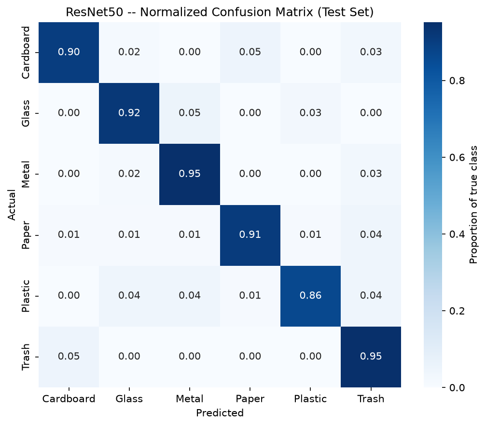
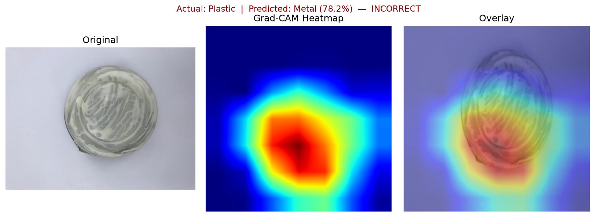

# Waste Classification AI

## Overview

An end-to-end deep learning system that classifies a photo of a waste item into one of six
categories — **Cardboard, Glass, Metal, Paper, Plastic, Trash** — so it can be sorted for
recycling. The objective was never just "get high accuracy": this project builds and
compares a CNN trained from scratch against three ImageNet-pretrained transfer-learning
models, evaluates all of them rigorously, explains *why* the best model works (error
analysis + Grad-CAM), and ships it as a working local demo.

## Why This Project?

Built as a portfolio project to demonstrate hands-on understanding of the full deep
learning workflow, not just calling a pretrained model:

```text
CNN architecture design            Fine-tuning
Training from scratch              Evaluation (precision/recall/F1, confusion matrices)
Transfer learning                  Error analysis
Freeze/unfreeze strategy           Explainability (Grad-CAM)
                                    Deployment (Streamlit)
```

## Dataset

**[TrashNet](https://github.com/garythung/trashnet)** (Gary Thung & Mindy Yang, Stanford),
resized variant — 2,527 images across six classes:

```text
Cardboard   Glass   Metal   Paper   Plastic   Trash
```

Downloaded automatically (no manual steps) via [`src/data/download.py`](src/data/download.py).

## Project Architecture

```text
Dataset (TrashNet)
        │
        ▼
EDA  ── class balance, image properties, sample inspection
        │
        ▼
Preprocessing  ── stratified 70/15/15 split, augmentation pipeline
        │
        ▼
CNN From Scratch  ── 4-block Conv/BatchNorm/ReLU/MaxPool + GAP baseline
        │
        ▼
Transfer Learning  ── MobileNetV2, EfficientNet-B0, ResNet50 (ImageNet-pretrained)
        │
        ▼
Fine-Tuning  ── Stage A (frozen backbone) → Stage B (unfrozen top layers, lower LR)
        │
        ▼
Evaluation  ── accuracy, precision, recall, F1, confusion matrices
        │
        ▼
Error Analysis  ── misclassified images, confusion patterns
        │
        ▼
Grad-CAM  ── visual explanation of model attention
        │
        ▼
Model Selection  ── accuracy vs. F1 vs. size vs. measured inference latency
        │
        ▼
Streamlit Deployment
```

## Model Comparison — Official Results

| Model | Accuracy | Macro F1 | Weighted F1 | Parameters |
|---|---:|---:|---:|---:|
| CNN (from scratch) | 63.68% | 0.621 | 0.650 | 390,918 |
| MobileNetV2 | 82.11% | 0.805 | 0.823 | 2,231,558 |
| EfficientNet-B0 | 80.53% | 0.788 | 0.808 | 4,015,234 |
| **ResNet50 (selected)** | **91.05%** | **0.894** | **0.913** | 23,520,326 |

All four trained locally on an **NVIDIA RTX 4050**, same dataset split, same seed (42), same
evaluation protocol. Full benchmark (inference latency, model size, deployment trade-offs)
in [`reports/model_comparison.md`](reports/model_comparison.md).

### Why Transfer Learning Beat the From-Scratch CNN

Transfer learning outperformed the from-scratch CNN by **17-27 accuracy points** across the
board. The reasons, without overclaiming:

- **ImageNet-pretrained features transfer.** MobileNetV2/EfficientNet-B0/ResNet50 were
  pretrained on 1.28M ImageNet images before ever seeing a waste photo — their early/middle
  layers already encode general-purpose edge, texture, and shape detectors that are useful
  for almost any image classification task, waste included.
- **Dataset size is the binding constraint for training from scratch.** TrashNet has only
  1,768 training images. A CNN starting from random weights has to learn everything —
  edges through object-level features — from that alone, which caps how much it can learn
  in a fixed epoch budget. Transfer learning sidesteps most of that by reusing already-
  learned representations.
- **Better initialization, not just more parameters.** The parameter count gap (2.2M-23.5M
  vs. 391K) is not the main driver — it's *what those parameters already encode* before
  training starts. A larger randomly-initialized CNN would not close this gap on its own.
- **Fine-tuning (Stage B) added a further, measurable gain on top of frozen-backbone
  feature extraction** — see the Stage A vs. combined-result deltas in
  `reports/results/{model}_test_metrics.json`: e.g. ResNet50 improved from 81.5% (Stage A
  best validation accuracy) to 91.05% (final test accuracy) after Stage B unfroze `layer4`.

This is not evidence that from-scratch CNNs are never viable — with a much larger dataset,
the gap would likely narrow. On a dataset this size, transfer learning is the clear
practical choice, which is exactly why the project builds both and compares them rather
than assuming the answer upfront.

## Error Analysis

Full report: [`reports/error_analysis.md`](reports/error_analysis.md). Evaluated the
**saved ResNet50 checkpoint** (no retraining) on the test set — re-verified accuracy
(91.05%) matched the official result exactly.

- **34 / 380 test images misclassified (8.9%).**
- **Strongest classes:** Cardboard and Paper (F1 = 0.931 each).
- **Weakest class:** Trash (F1 = 0.760) — a *precision* problem (63.3%), not a recall
  problem (95.0% recall, the class-weighted loss working as intended) — the model rarely
  misses real trash, but pulls in ambiguous `paper` and `plastic` images.
- **Most confused pairs:** `glass→metal` and `paper→trash` (4 errors each), followed by
  `plastic→metal`, `plastic→glass`, `cardboard→paper` (3 each).
- Several high-confidence errors are genuinely ambiguous source images — a paper-exterior
  bubble mailer (labeled Plastic, predicted Paper at 97.8%), a glossy blue paper tube
  (labeled Paper, predicted Metal at 95.9%) — where the photographed object legitimately
  combines two materials.



## Explainability (Grad-CAM)

Full report: [`reports/gradcam_analysis.md`](reports/gradcam_analysis.md). Grad-CAM
visualizes which image regions most influenced ResNet50's prediction — **a visualization of
contribution, not proof of causality.**

**Finding:** across every example tested (correct and incorrect), the model consistently
attends to the photographed object itself — never the plain studio background — and its
errors trace back to genuine visual material ambiguity (a shiny plastic lid that looks
metallic, a glossy black plastic tub that looks like glass) rather than poor localization
or background shortcuts.



## Final Model Selection

Full analysis (including measured inference latency, not assumptions):
[`reports/model_comparison.md`](reports/model_comparison.md).

**Selected: ResNet50.** Benchmarked single-image inference latency on the RTX 4050
(100 timed runs, 10 warm-up runs excluded): ResNet50 averages **7.3ms**, actually *faster*
than EfficientNet-B0 (12.6ms, despite having 6x fewer parameters — kernel-launch overhead
dominates at batch size 1) and close to MobileNetV2 (6.3ms). Since this project's deployment
shape is single-image upload (not batch/edge-constrained), latency is not a meaningful
differentiator — so the decision comes down to accuracy and F1, where ResNet50 leads
decisively. **MobileNetV2 is documented as the recommended alternative** for a
storage/edge-constrained deployment scenario (8.75MB vs. 90MB).

## Deployment (Streamlit)

```bash
pip install -r requirements.txt
streamlit run app/streamlit_app.py
```

The app loads the saved `models/resnet50_best.pt` checkpoint (via `models/model_metadata.json`
— never hardcoded in multiple places) and **never trains anything**. It automatically detects
CUDA and falls back to CPU if unavailable, using the exact same preprocessing pipeline
(`src/data/transforms.py`) as training/evaluation. Upload a JPG/JPEG/PNG to see the
predicted class, confidence, top-3 predictions, all six class probabilities, model name, and
inference latency.

## Project Structure

```text
waste-classification-ai/
├── app/
│   └── streamlit_app.py           # Deployment demo (loads saved model, no training)
├── data/
│   ├── raw/                       # Downloaded dataset (gitignored)
│   └── processed/splits.csv       # Reproducible train/val/test split manifest
├── notebooks/
│   ├── 01_eda.ipynb
│   ├── 02a_cnn_from_scratch_smoke_test.ipynb    # CPU pipeline check — NOT final results
│   ├── 02b_cnn_from_scratch_final.ipynb         # Official Phase 3 training (RTX 4050)
│   ├── 03a_transfer_learning_smoke_test.ipynb   # Mechanics check only — no training
│   └── 03b_transfer_learning_final.ipynb        # Official Phase 4 training (RTX 4050)
├── src/
│   ├── data/          # Download, dataset scanning, stratified split, transforms
│   ├── models/         # CNN architecture, transfer-learning builders, freeze/unfreeze
│   ├── training/       # Training loop, early stopping, class weighting
│   ├── evaluation/      # Metrics, confusion matrices, error analysis, Grad-CAM
│   └── utils/          # Config, device detection, seeding
├── models/
│   ├── *_best.pt                  # Final trained checkpoints (gitignored — see below)
│   ├── model_metadata.json        # Architecture/classes/preprocessing config (tracked)
│   └── archive/                   # Superseded smoke-test checkpoint, clearly labeled
├── reports/
│   ├── error_analysis.md
│   ├── gradcam_analysis.md
│   ├── model_comparison.md
│   ├── figures/                   # All plots (EDA, training curves, confusion matrices,
│   │   ├── error_analysis/        # Misclassified-image grid
│   │   ├── gradcam/                # Grad-CAM panels
│   │   └── archive/                # Superseded/smoke-test figures, clearly labeled
│   └── results/                   # Raw metrics/history JSON per model
├── requirements.txt
├── LICENSE
└── .gitignore
```

## Reproducibility

| Component | Value |
|---|---|
| Python | 3.12.10 |
| PyTorch | 2.11.0+cu126 (CUDA 12.6 build) |
| torchvision | 0.26.0+cu126 |
| GPU | NVIDIA GeForce RTX 4050 Laptop GPU, 6GB VRAM |
| NVIDIA driver | 610.88 |
| Random seed | 42 (Python / NumPy / PyTorch — `src/utils/seed.py`) |
| Dataset source | [TrashNet](https://github.com/garythung/trashnet), resized variant |
| Train / Val / Test split | 70% / 15% / 15%, stratified by class (`src/data/splitter.py`) |

Device selection is automatic everywhere
(`torch.device("cuda" if torch.cuda.is_available() else "cpu")`,
[`src/utils/device.py`](src/utils/device.py)) — every script/notebook runs on GPU or falls
back to CPU without modification.

### Installation

```bash
python -m venv .venv
.venv\Scripts\activate          # Windows
# source .venv/Scripts/activate  # Git Bash / WSL

# Install the CUDA build matching your GPU driver first (skip on CPU-only machines —
# the next command will install the CPU build instead)
pip install torch==2.11.0+cu126 torchvision==0.26.0+cu126 --index-url https://download.pytorch.org/whl/cu126

pip install -r requirements.txt
python -m src.data.download
```

## Future Improvements

- Larger, more diverse dataset (more images per class, especially `trash`)
- More varied real-world backgrounds (current dataset is uniform studio photography)
- Better class balancing beyond loss weighting (targeted data collection for `trash`)
- More extensive/targeted augmentation (e.g. reducing reliance on glossiness as a metal cue)
- Systematic hyperparameter optimization (currently manually chosen, documented defaults)
- Confidence calibration (so reported confidence better reflects true correctness likelihood)
- Model quantization for smaller deployment footprint
- ONNX export for cross-framework/production deployment
- Edge/mobile deployment (MobileNetV2 is already the natural candidate — see
  `reports/model_comparison.md`)
- Additional explainability methods beyond Grad-CAM (e.g. SHAP, integrated gradients) for
  cross-validation of the attention findings
